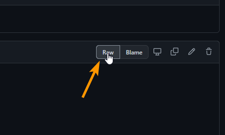
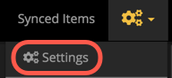
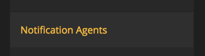
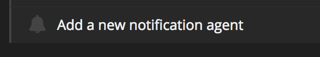
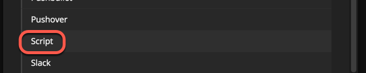
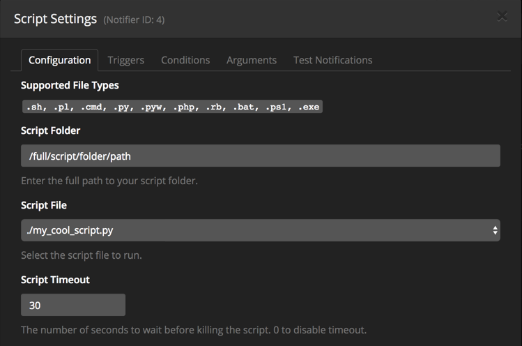
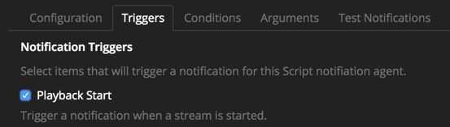
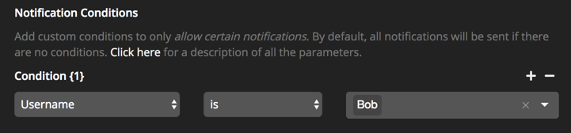
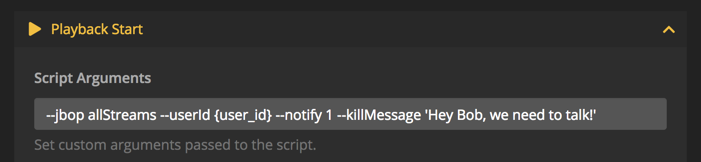
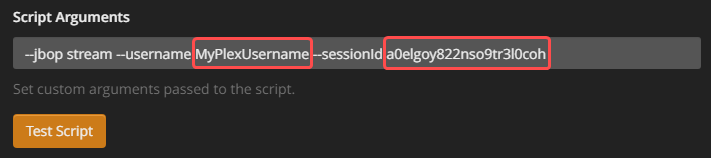

## How to Download Scripts from Github

Click on the <kbd>Raw</kbd> button on the script page to get the actual script file, then use File > Save As.. to save the script.

_**Do not**_ use right click > Save As.. on the script link as this will save the HTML GitHub page instead of the script.




## How to Set Up a Custom Script in Tautulli

1. Go to Settings > Notification Agents > Add a new notification agent > Script.

    

    

    

    

1. Set a "Script Folder" and select a "Script File".
    * Note: A script folder on a mounted path requires `allow_mounted_folders = 1` in the Tautulli config file.

    

1. Select the triggers that will be used to run the script. (e.g. Playback Start, Playback Stop).

    

1. If you want to limit when the script runs, add [custom conditions](./custom-notification-conditions.md) to the agent.

    

1. Set the arguments that should be passed to the script.
    * Note: _Do not_ fill in the Tautulli notification `{parameters}`.

    

1. Save. Voilà, all done!

1. If you are using the "Test Notifications" tab for the script, you _must_ fill in all the Tautulli `{parameters}` with actual values.
    * For example script arguments:
        ```
        --jbop stream --username {username} --sessionId {session_id}
        ```
    * You _must_ fill in the `{username}` and `{session_id}`:
        ```
        --jbop stream --username MyPlexUsername --sessionId a0elgoy822nso9tr3l0coh
        ```

    


## Environment Variables

Tautulli will pass the following environment variables to the script.

| Variable | Description |
| --- | --- |
| `PLEX_URL` | The URL used to connect to the Plex server (e.g. `http://127.0.0.1:32400`). |
| `PLEX_TOKEN` | The admin's Plex token. |
| `PLEX_USER_TOKEN` | The user's Plex token only available for notifications with a user context (i.e. Playback triggers). |
| `TAUTULLI_URL` | The URL used to connect to the Tautulli server (e.g. `http://127.0.0.1:8181`). |
| `TAUTULLI_PUBLIC_URL` | The Public Tautulli Domain only if set in the Tautulli settings. |
| `TAUTULLI_APIKEY` | The Tautulli API key. |
| `TAUTULLI_ENCODING` | The system encoding used by Tautulli (e.g. `UTF-8`). |
| `TAUTULLI_PYTHON_VERSION` | The Python version running Tautulli (e.g. `3.14.0`). |
| `PLEXAPI_LOG_PATH` | The path to the `plexapi_script.log` file in the Tautulli logs folder. |


## Windows Script Guide

**Note**: These instructions only apply if you are running a Python script.


### How to Install Python

1. Download the Python install manager from [python.org](https://www.python.org/downloads/) and run it.

1. Click Install Python and follow the on screen prompts (answer yes (`y`) to all the options).

1. You can check if Python is installed properly by opening up the Windows powershell and running the command `python -V` (note capital letter `V`) and it should tell you the version of Python installed. ([screenshot](./images/python_installation_3.png))


### How to Install Python Packages

1. Check which Python packages your script requires. Some script authors will list the requirements at the top of the script ([example](https://github.com/blacktwin/JBOPS/blob/master/utility/hide_episode_spoilers.py#L6)), otherwise contact the script author. You can also just try running the script (see below) and see which `ModuleNotFoundError` you get which will tell you which packages are needed.
    * Example error message: `ModuleNotFoundError: No module named 'plexapi'` means you need to install the `plexapi` package.

1. Install packages by opening up the command line and running the command:
    ```
    python -m pip install <package>
    ```
    * Example to install the `plexapi` package ([screenshot](./images/pip_install_plexapi.png)):
        ```
        python -m pip install plexapi
        ```
    * Example to install the `requests` package ([screenshot](./images/pip_install_requests.png)):
        ```
        python -m pip install requests
        ```


### How to Run a Python Script Manually

Open up the command line and run the script you downloaded using Python with the following command:
```
python "<path to script file>" --additional arguments
```
* Note: `--additional arguments` depends on the individual script.
* Example:
    ```
    python "C:\Users\JohnDoe\Documents\Scripts\hide_episode_spoilers.py" --rating_key 69420 --blur 25
    ```


## List of User Created Scripts

### Visit the [JBOPS GitHub Repository](https://github.com/blacktwin/JBOPS) for more up-to-date scripts created by @Blacktwin.


### Tautulli Scripts:

| Description | Language | Author |
| --- | --- | --- |
| [Kill streams](https://github.com/blacktwin/JBOPS/blob/master/killstream/) | Python | [blacktwin](https://github.com/blacktwin) |
| [Throttle nzb client](https://gist.github.com/Hellowlol/a5d0cab4bde185b38404) | Python | [Hellowlol](https://gist.github.com/Hellowlol) |
| [Send an Email notification to users when a new episode to their "favorite" show have been added to Plex](https://github.com/blacktwin/JBOPS/blob/master/notify/notify_user_favorites.py) | Python | [blacktwin](https://gist.github.com/blacktwin) |
| [Send a Tautulli notification with the movie directors' IMDB page](https://gist.github.com/JonnyWong16/d508d8d5d1fcb336efc1a3d167eb7b1a) | Python | [JonnyWong16](https://gist.github.com/JonnyWong16) |
| [Send a random Chuck Norris joke when a movie starring Chuck Norris is played](https://gist.github.com/JonnyWong16/6e3b07bbc99eeb15183ba86be5bdf9a7) | Python | [JonnyWong16](https://gist.github.com/JonnyWong16) |
| [Send a Tautulli notification with geolocation data](https://gist.github.com/JonnyWong16/48d6362884b5edbf5e6d78859035183a) | Python | [JonnyWong16](https://gist.github.com/JonnyWong16) |
| [Get notified when Plex disk usage exceeds a certain threshold](https://gist.github.com/JonnyWong16/f561f06a6266db66dad9) | Python | [JonnyWong16](https://gist.github.com/JonnyWong16) |
| [Delete Tautulli history older than "X" days](https://gist.github.com/JonnyWong16/cb1b53e71b89d2159313) | Python | [JonnyWong16](https://gist.github.com/JonnyWong16) |
| [Restart Plex](https://gist.github.com/Hellowlol/daaa7aa4c5f8bd54033895df5a5fb2d2) | bat | [Hellowlol](https://gist.github.com/Hellowlol) |
| [Plex Docker Container Restart with Rancher](https://gist.github.com/JigSawFr/70d7f95f16f1f6f27528a18e183ee67c) | Bash | [JigSawFr](https://gist.github.com/JigSawFr) |
| [Generate map from user geolocation data](https://github.com/blacktwin/JBOPS/tree/master/maps) | Python | [blacktwin](https://gist.github.com/blacktwin) |
| [Get notified when new IP address accesses Plex](https://github.com/blacktwin/JBOPS/blob/master/notify/notify_newip.py) | Python | [blacktwin](https://gist.github.com/blacktwin) |
| [Run a SSH command using Python](https://gist.github.com/JonnyWong16/e140f546b09950829685f000b7cf98bc) | Python | [JonnyWong16](https://gist.github.com/JonnyWong16) |
| [Automatically add a label to recently added items](https://gist.github.com/JonnyWong16/4cfcf8ea50dab1b720b4d30e9a01835c) | Python | [JonnyWong16](https://gist.github.com/JonnyWong16) |
| [Automatically mark a multi-episode file as watched in Plex](https://gist.github.com/JonnyWong16/7708c5e755c74e169c115490b0749279) | Python | [JonnyWong16](https://gist.github.com/JonnyWong16) |
| [Automatically change episode artwork in Plex to hide spoilers](https://gist.github.com/JonnyWong16/ea8f51f674fdb4ebf4e47e53cd1a10e5) | Python | [JonnyWong16](https://gist.github.com/JonnyWong16) |
| [Updates all metadata in the Tautulli database after moving Plex libraries](https://gist.github.com/JonnyWong16/f554f407832076919dc6864a78432db2) | Python | [JonnyWong16](https://gist.github.com/JonnyWong16) |
| [Send recently added through native iOS push (OneSignal)](https://gist.github.com/LuisNunezC/64a3e677887c8ffb76e0f0de1c43311b) | Python | [LuisNunezC](https://github.com/LuisNunezC) |
| [Notify Sonarr that a plexDVR recording has been added to the library](https://gist.github.com/metaMMA/4ecd6579476fce7e93b6c8a5271c12ae) | Bash | [metaMMA](https://github.com/metaMMA) |
| [Notification script for Facebook Groups](https://gist.github.com/spuniun/56624e1464c621c91e52f88e03321582) | Python | [spuniun](https://github.com/spuniun) |


### Other Plex Scripts:

| Description | Language | Author |
| --- | --- | --- |
| [Automatically share and unshare libraries for Plex users](https://gist.github.com/JonnyWong16/f8139216e2748cb367558070c1448636) | Python | [JonnyWong16](https://gist.github.com/JonnyWong16) |
| [Execute a command when no Plex sessions are active](https://gist.github.com/JonnyWong16/bc50c882985cc495e629f41c12bc7590) | Python | [JonnyWong16](https://gist.github.com/JonnyWong16) |
| [Create a Plex collection from a text file list of rating keys](https://gist.github.com/JonnyWong16/148b5a5dc39211bd6a871cb8f9df8c48) | Python | [JonnyWong16](https://gist.github.com/JonnyWong16) |
| [Sync Plex playlists to shared users](https://gist.github.com/JonnyWong16/2607abf0e3431b6f133861bbe1bb694e) | Python | [JonnyWong16](https://gist.github.com/JonnyWong16) |
| [Removes ALL collections from ALL movies](https://gist.github.com/JonnyWong16/34878448ab45dfffffa930f5cf8c252a) | Python | [JonnyWong16](https://gist.github.com/JonnyWong16) |
| [Saves artist.jpg to the Artist folder.](https://gist.github.com/JonnyWong16/8ede4aabce105217a70cc2386ce673f7) | Python | [JonnyWong16](https://gist.github.com/JonnyWong16) |
| [Randomly create haiku based on Plex libraries content.](https://github.com/blacktwin/JBOPS/blob/master/fun/plexapi_haiku.py) | Python | [Blacktwin](https://gist.github.com/Blacktwin) |
| [Create a Plex Playlist with what was aired today in history.](https://github.com/blacktwin/JBOPS/blob/master/fun/playlist_manager.py) | Python | [Blacktwin](https://gist.github.com/Blacktwin) |
| [Pull Movie and TV Show poster images from Plex.](https://github.com/blacktwin/JBOPS/blob/master/utility/plex_api_poster_pull.py) | Python | [Blacktwin](https://gist.github.com/Blacktwin) |
| [Download theme songs from Plex TV Shows.](https://github.com/blacktwin/JBOPS/blob/master/utility/plex_theme_songs.py) | Python | [Blacktwin](https://gist.github.com/Blacktwin) |
| [Delete shows that a list of users have watched.](https://github.com/blacktwin/JBOPS/blob/master/utility/delete_watched_TV.py) | Python | [Blacktwin](https://gist.github.com/Blacktwin) |
| [Delete movies that a list of users have watched.](https://github.com/blacktwin/JBOPS/blob/master/utility/remove_watched_movies.py) | Python | [Blacktwin](https://gist.github.com/Blacktwin) |
