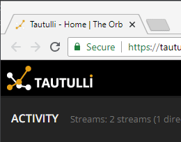
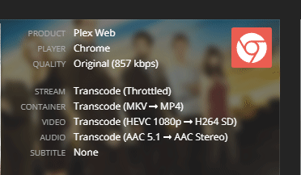

This page guides you through some common debugging steps to verify the information in Tautulli.

## Activity

_Triple_ clicking on the word `ACTIVITY` at the top of the Tautulli page will open up the raw XML file on your Plex server that Tautulli is parsing in order to show you the current activity on the server. Tautulli first opens a page that shows the "Plex XML URL". Click "Sign In" to sign in with Plex and view the XML.

If you are accessing Tautulli from outside your network and the address that Tautulli uses to connect to Plex isn't available you will need to fix the location in the "Plex XML URL" box before you sign in. If you find yourself using this XML shortcut often you can have Tautulli automatically override the link for you by shutting down Tautulli, editing `config.ini`, and editing the `pms_url_override` value to the public location of your Plex server.

_Note:_ Your browser will likely block this at first since it is a pop-up! You'll need to allow pop-ups in your browser for your Tautulli domain, instructions for the Chrome browser can be found [here](https://support.google.com/chrome/answer/95472?co=GENIE.Platform%3DDesktop&hl=en).

## Stream Info

You can view the information that Tautulli has parsed from the raw XML data for a particular stream by _single_ clicking on the `STREAM` word in an activity card:

This information can be handy to check against when using text parameters or conditions in a Notification Agent.

## More XML Shortcuts

Similar to triple clicking on the word `ACTIVITY` on the home page, if you _triple_ click on one of the following you will be brought to the XML that the data is being generated from:

* "All Libraries" on the Libraries page
* "All Users" on the Users page
* "PLEX MEDIA SERVER" under Settings -> Plex Media Server
* The [last breadcrumb](./images/debugging_breadcrumb.png) on any media info page
* "RECENTLY ADDED" on the home page

## Scheduled Tasks

Under Settings -> Help & Info Tautulli shows you a listing of the scheduled tasks currently active on your system. You can click on the following tasks to get a pop-up with a detailed listing of their relevant information:
* _Check for active sessions_
    * Click for a listing of currently active sessions and when they will be flushed to the database if Plex fails to send a stop event for them
* _Check for recently added items_
    * Click for a listing of items that Tautulli has recently seen get added to Plex, and when they are scheduled to be announced
